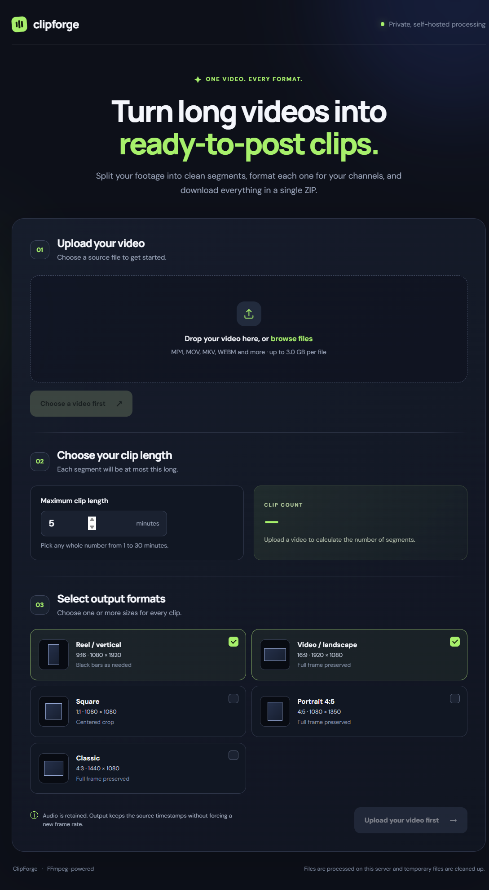
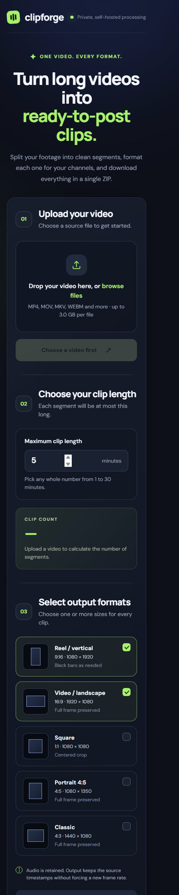

# ClipForge — long-form video clipper

ClipForge is a single-page video processing app with a FastAPI backend and FFmpeg. Upload one video, choose a maximum segment length (1–30 minutes), select one or more output aspect ratios, and download a single ZIP containing every successful clip.

Current release: **v1.2.0**

### v1.2.0 highlights

- Added a ClipForge Studio dashboard layout inspired by the supplied reference.
- Added real source preview and generated timeline waveform after file selection.
- Added a derived clip queue with selectable segments and source seeking.
- Added segmentation presets that update the active clip-length setting.
- Added local-engine, storage, and retention status panels without claiming unsupported AI services.

### v1.1.2 highlights

- Refined the interface using a local video-studio dashboard layout.
- Added capability status cards and clearer workflow hierarchy.
- Improved light-theme contrast and keyboard focus visibility.

### v1.1.1 highlights

- Fixed theme switching with complete light-theme surface and control colors.
- Added a responsive three-step workflow navigator for upload, configuration, and processing.

### v1.1.0 highlights

- Cancel an in-progress upload and remove its server-side session.
- Validate file type and size before upload with actionable error messages.
- Switch between dark and light themes; the preference is saved locally.
- Keep a local list of recent completed jobs with one-click downloads.

## Screenshots

### Desktop



### Mobile



## Architecture decision: server-side FFmpeg

This implementation processes videos on the server rather than in the browser. That is a more practical fit for long videos, multiple output encodes, audio retention, and consistent output quality. The browser uploads the source in 8 MiB chunks; the API stores each accepted chunk and reports the current byte offset, so a retry can continue from the last server-saved byte. FFmpeg renders each `(part, format)` independently and emits machine-readable progress; a failed output is recorded and the remaining outputs continue. Successful files are packaged as `reel/part1.mp4`, `video/part1.mp4`, `square/part1.mp4`, etc.

## Fastest setup: Docker

Requirements: Docker Desktop (Windows/macOS) or Docker Engine + the Compose plugin (Linux).

From this folder, run:

```bash
docker compose up --build
```

Open [http://localhost:8000](http://localhost:8000).

Uploaded videos and temporary files are stored under `./data`. Stop the application with `Ctrl+C`; run `docker compose down` to stop the container.

## Run locally without Docker

Requirements: Python 3.11+ and a recent FFmpeg build that includes `ffmpeg`, `ffprobe`, and the `-fps_mode passthrough` option.

1. Install FFmpeg and ensure both `ffmpeg` and `ffprobe` work from your terminal.
   - Windows: install an FFmpeg build and add its `bin` directory to `PATH`.
   - macOS: `brew install ffmpeg`
   - Debian/Ubuntu: `sudo apt-get update && sudo apt-get install ffmpeg`
2. From this folder, create a virtual environment and install dependencies:

   ```bash
   python -m venv .venv
   # Windows PowerShell:
   .venv\Scripts\Activate.ps1
   # macOS/Linux:
   source .venv/bin/activate
   pip install -r requirements.txt
   ```

3. Start the API and static frontend:

   ```bash
   uvicorn app:app --host 127.0.0.1 --port 8000
   ```

4. Visit [http://127.0.0.1:8000](http://127.0.0.1:8000).

Run one Uvicorn worker for this demo because active job state is held in process memory. Data files themselves are persisted under `./data` (or `DATA_DIR`).

## Limits and configuration

Defaults are intentionally conservative for a self-hosted starter:

| Setting | Default | Purpose |
|---|---:|---|
| `MAX_UPLOAD_BYTES` | `3221225472` (3 GiB) | Maximum source file size |
| `MAX_DURATION_SECONDS` | `10800` (3 hours) | Maximum accepted video duration |
| `CHUNK_BYTES` | `8388608` (8 MiB) | Resumable upload chunk size |
| `UPLOAD_TTL_SECONDS` | `86400` (24 hours) | Expiration for abandoned uploads |
| `JOB_TTL_SECONDS` | `21600` (6 hours) | Expiration for finished ZIP files |
| `FFMPEG_PRESET` | `veryfast` | FFmpeg speed/CPU trade-off |
| `FFMPEG_CRF` | `23` | H.264 quality (lower is higher quality/larger files) |

Set environment variables before starting the app, or edit `docker-compose.yml`. Increasing the size/duration limits needs sufficient disk space, memory and CPU. For videos beyond this demo's limits, lower the source size/duration or deploy a dedicated server/worker with more resources.

## Output behavior

- Segment numbering is consistent across every selected format: `part1.mp4` through `partN.mp4`.
- The final segment is the remaining duration and is shorter when the source duration is not an exact multiple of the chosen length.
- Reel (9:16), landscape (16:9), portrait 4:5 and classic 4:3 preserve the entire source frame and add black padding where needed. Square output uses a centered crop.
- The original audio content is retained when present and encoded to AAC for MP4 compatibility. Video is encoded as H.264, with source timestamps passed through; no output frame rate is requested, and the pipeline does not deliberately downsample the frame rate.
- If an output fails, its error is listed and other outputs continue. The ZIP includes successful outputs only; each included file is in a folder named for its format.
- The ZIP is deleted after download. The input source and rendered intermediates are removed after processing. Abandoned upload sessions expire after 24 hours, and finished job files expire after 6 hours by default.

## API overview

- `GET /api/health` — FFmpeg availability and configured limits.
- `POST /api/uploads` — create an upload session.
- `GET /api/uploads/{upload_id}` — inspect the stored byte offset and completion state.
- `PATCH /api/uploads/{upload_id}` — append one binary chunk with the `Upload-Offset` header.
- `POST /api/uploads/{upload_id}/complete` — verify the source with `ffprobe`.
- `POST /api/jobs` — start processing with `upload_id`, `clip_length_minutes`, and `formats`.
- `GET /api/jobs/{job_id}` — inspect progress and per-output failures.
- `GET /api/jobs/{job_id}/download` — download the ZIP (server-side ZIP is removed after response).

## Production hardening notes

This is a runnable starter, not a public multi-tenant service. It has no login, per-user quotas, rate limiting, or distributed job queue. Before exposing it to the internet, add authentication and request throttling, use TLS, configure reverse-proxy upload/body/time limits, monitor disk usage, and move job state to a durable database/queue (for example PostgreSQL plus a worker queue). Limit concurrent encodes based on CPU capacity. Keep the `data` directory private because it contains uploaded media and generated clips while a job is running.
